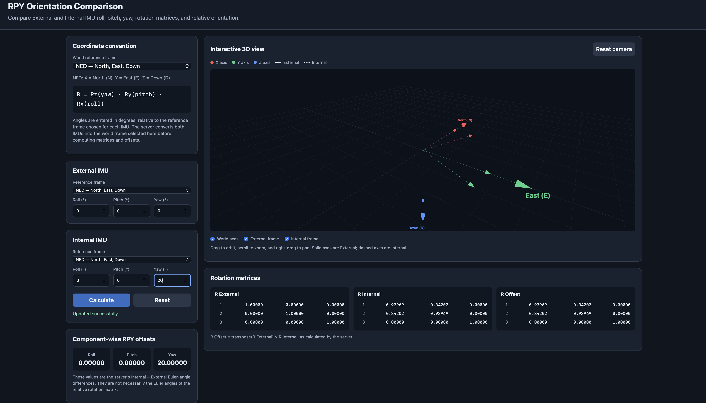

# RPY Orientation Comparison

A small local web application for comparing roll, pitch, and yaw (RPY) values from External and Internal IMUs. The C++ HTTP server converts sensor orientations between reference frames and calculates rotation matrices and component-wise angle differences. The HTML/JavaScript frontend displays the results and visualizes the orientations using Three.js.

## Project layout

```text
project-folder/
├── CMakeLists.txt
├── src/              # Server, service handler, rotations, and reference frames
├── third_party/
│   └── httplib.h     # Vendored cpp-httplib
├── web/
│   └── index.html    # Web UI and Three.js scene
├── docs/
│   ├── README.md
│   └── image.png     # Frontend screenshot
└── build/            # Generated build output; serves its own www/ directory
```

The server serves static files from `./www`, relative to its working directory. Copy `web/index.html` to `build/www/index.html` and run the executable from `build/` as shown below.

## Requirements

- CMake 3.16 or later and a C++17 compiler.
- A modern browser with WebGL support.
- Internet access for the frontend to load Three.js 0.128.0 and OrbitControls from jsDelivr.

## Build and run

From the project root:

```bash
cmake -S . -B build
cmake --build build
mkdir -p build/www
cp web/index.html build/www/index.html
cd build
./rpy_server
```

The server listens on `127.0.0.1:8080`. Open this address in your browser:

```text
http://127.0.0.1:8080/
```

Keep the terminal running while using the page. If your existing project uses a different build command, continue using that command.

## Unit tests

GoogleTest is used for the rotation and reference-frame tests. CMake uses an installed GoogleTest package or fetches a pinned version when needed.

```bash
cmake -S . -B build -DBUILD_TESTING=ON
cmake --build build --target rpy_unit_tests
ctest --test-dir build --output-on-failure
```

## Code formatting

With `clang-format` installed, format the maintained C++ files using the repository's `.clang-format` rules:

```bash
clang-format -i src/*.cpp src/*.h tests/*.cpp
```

Check formatting without changing files:

```bash
clang-format --dry-run --Werror src/*.cpp src/*.h tests/*.cpp
```

Formatting is currently run manually; it is not part of the build or configured to run on save.

To enable the repository's pre-commit formatting check in this clone, run once:

```bash
git config core.hooksPath .githooks
```

The hook checks staged C++ files and blocks commits with formatting issues. It requires `clang-format` to be installed.

## Continuous integration

GitHub Actions runs the CMake build and unit tests on each push and pull request.

## Static analysis

With `clang-tidy` installed, run the opt-in lint target:

```bash
cmake -S . -B build
cmake --build build --target rpy_lint
```

CMake searches `PATH` and common Homebrew LLVM locations. The target checks server and unit-test sources with clang-analyzer, bugprone, performance, and selected modernization checks, excluding vendored headers; normal builds do not run it.

## How the application works



### API: reference frames

`GET /api/frames` returns the default frame and the frames offered by the frontend. The default is `NED`; the current list is `NED`, `ENU`, `NWU`, `SEU`, and `SWD`. Each frame entry includes its axis labels and the matrix used to map it into the 3D display. The backend also accepts other valid right-handed three-axis combinations formed from North/South, East/West, and Up/Down; frame codes are case-insensitive. Unknown or left-handed codes return HTTP 400.


### API: calculate orientations

`GET /api/offsets` requires these six finite numeric parameters, in degrees:

```text
external_roll, external_pitch, external_yaw,
internal_roll, internal_pitch, internal_yaw
```

Example URL (line breaks added for readability; use one line in a browser):

```text
http://127.0.0.1:8080/api/offsets?external_roll=0&external_pitch=0&external_yaw=0&internal_roll=0&internal_pitch=0&internal_yaw=90&frame=NED&external_frame=ENU&internal_frame=NED
```

The optional `frame` parameter selects the output/world frame and defaults to `NED`. `external_frame` and `internal_frame` identify the frames in which each sensor's angles were reported; each defaults to `frame`. Angles are converted to radians for the rotation calculations.

The response includes the selected frame, the input RPY values, component-wise offsets, and `R_external`, `R_internal`, and `R_offset`. Input RPY values are returned as supplied. The rotation matrices are expressed in the selected output frame; `R_offset` is calculated as:

```text
R_offset = transpose(R_external) * R_internal
```

The component-wise offsets are calculated from the two orientations expressed in the selected output frame:

```text
roll_offset  = internal_roll  - external_roll
pitch_offset = internal_pitch - external_pitch
yaw_offset   = internal_yaw   - external_yaw
```

These Euler-angle differences are **not generally equivalent** to extracting Euler angles from the relative matrix. Missing, invalid, non-finite angles or invalid frame codes return HTTP 400 with a JSON error.